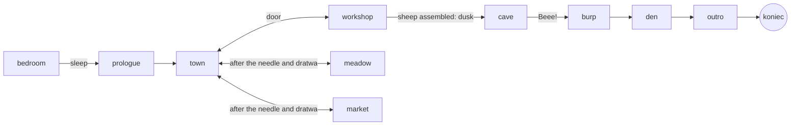
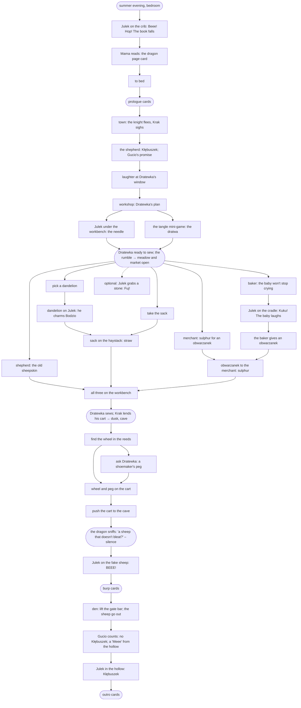

# Gucio i Julek Odkrywają Polskę – Tajemnica Smoka Wawelskiego: game design

Status: **approved by the user** (2026-11-22), including the changes from the brief. Source: `story/brief.md` (approved).

The game stands alone: nothing in the story refers to other games in the series. It
reuses the series' art style, the two brothers (refs, sprites, voices, speech rules),
Mama's and the narrator's voices, and the boys' bedroom.

## Design rules (series)
- **Real-world logic, legend magic.** The only magic is the dream itself and the dragon.
  Everything the boys *do* works the way a 6-year-old knows it. A small boy fits under a
  workbench. A grumpy ram likes a dandelion. A crying baby laughs at peekaboo.
- **No failure, no game over.** A wrong move gets a funny line. The dragon waits for as
  long as the player needs.
- **Everything is voiced.** Gucio speaks in 1–2 short sentences. Julek speaks in 1–2 words
  from his approved list (`characters/julek.md`).
- **A legend, not history.** Mama reads it as a legend, and the narrator frames it.
- **Story depth** (`story/brief.md`, "Story Depth"): a named stake (Kłębuszek), a promise
  paid off at the end, an arc for every main character, show-don't-tell, and one fact card.

## Premise
It's a warm summer evening. Julek is a sheep tonight ("Beee! Beee!") and bounces in his
crib until the book about Poland falls off the shelf. Mama reads the legend of the Wawel
dragon and stops at the cliffhanger. The boys fall asleep *into* the story. A greedy
dragon has been taking the town's sheep, last night the old shepherd's little lamb
Kłębuszek. The knights ran away. Only the shoemaker Dratewka has a plan, and everyone
laughs at him.

The boys promise the shepherd to bring Kłębuszek home. They help Dratewka find his
needle and thread, fetch a sheepskin and straw from the meadow and a smelly yellow
stone from the market, and build a sheep that isn't a sheep. At dusk, the dragon
isn't fooled by a sheep that doesn't bleat, until Julek, hidden behind it, says "Beee!"
The dragon swallows it, drinks half the Vistula, burps, and flies away. The boys free
the sheep from his cave, Julek finds Kłębuszek, and the town cheers Krak's name:
Kraków. In the morning Julek is holding a tuft of white wool.

## Tone
Warm, funny, summery, never scary. The dragon is big, green, greedy and silly: he hoards
sheep "na później" ("for later") and counts them like treasure. Night scenes are cosy
and moonlit, and the cave glows orange from the dragon's nostrils and his fire pit.
Julek provides the jokes (the knight's helmet, the "Fuj!" stone, the bleat).

## Audience and language
- Players are around 6, often with a parent. Many can't read. Polish only.
- Target playtime: **20–30 minutes**: a bedroom tutorial, six dream scenes, three card
  sequences.

## Protagonists and core mechanic (series)
- **Gucio** walks (taps move him). He picks up, reaches, talks, plans and pushes.
- **Julek** follows as a companion, and his face is the **first, permanent inventory
  slot**. Tap Julek, then a thing. Each puzzle uses a *different* Julek trick:

| where | Julek's trick |
|---|---|
| bedroom | **bounce**: "Beee! Hop!" in his crib shakes the book off the shelf (the setup for the climax) |
| workshop | **crawl**: under the workbench for Dratewka's needle |
| meadow | **charm**: gives the grumpy ram a dandelion and strokes his nose |
| market | **peekaboo**: "Kuku!" makes the baker's crying baby laugh |
| market (optional gag) | **grab**: snatches a sulphur stone, sniffs it: "Fuj!" |
| cave | **noise**: "Beee!" behind the fake sheep (his only noise trick) |
| dragon's den | **crawl** again, on purpose: into the hollow for Kłębuszek (the emotional twin of the needle) |

- **Item on Julek:** giving Julek an item makes him use it (the dandelion). That's a
  combo in `combos.ts`, which the engine already supports.
- When Julek has nothing to do, he says something toddler-ish and Gucio comments
  (the series' `_.julek.fail.*` lines and VO are reused).
- **The wrong-brother line** teaches the Julek slot without text: "Za mała dziura dla
  mnie… Julek by się zmieścił!" ("Too small a hole for me… Julek would fit!")

## Controls (series)
One tap does everything. Big inventory icons run along the bottom, with Julek first.
Hints: tap Gucio to hear the last hint again, talk to Julek for a hint, and after 40 s
without progress Julek points and says a word.

## Collectibles: glowing wool tufts (optional)
The dragon carried the sheep through town, and tufts of wool caught on fences, bushes
and rocks. They glow softly, so they also show the way (the brief's hint system).
There are **12**: 3 each in `town`, `meadow`, `market` and `cave`. They're partly
visible, and 3 of them only Julek can reach. The series' `counter` HUD shows them with
a wool icon. With all 12, the ending gets a bonus card: Kłębuszek jumps over the boys
at the feast, the way he used to on the meadow (`outro.bonus`). Nothing depends on them.

## Scenes
| id | name | act | time | role |
|---|---|---|---|---|
| `bedroom` | Pokój chłopców, letni wieczór | I | evening / morning | tutorial: Julek's Beee-bounce shakes the book down; Mama reads; sleep |
| `prologue` | Sen (cards) | I | night → morning | the shepherd counts sheep; the dragon's eyes; the empty fold; the knights flee; the boys wake by the Vistula |
| `town` | Osada pod Wawelem | II | morning | the hub. The knight flees; Krak's despair; the shepherd's promise; laughter at Dratewka's window |
| `workshop` | Warsztat Dratewki | II, IV | morning | Dratewka's plan; the needle (Julek) and the dratwa (mini-game); later, the assembly |
| `meadow` | Łąka pasterza nad Wisłą | III | midday | the sheepskin from the shepherd; straw past the ram Bodzio |
| `market` | Targ | III | midday | the trade: baby → obwarzanek → sulphur |
| `cave` | Smocza jama (outside) | V | dusk | fix Krak's cart; the dragon isn't fooled; Julek's "Beee!" |
| `burp` | Smok odlatuje (cards) | V | dusk → night | gulp, drinking the Vistula, the balloon, BEEEK, flight |
| `den` | W smoczej jamie | V | night | open the gate for the sheep; Julek finds Kłębuszek |
| `outro` | Kłębuszek wraca do domu (cards + bedroom morning) | – | sunset → morning | the reunion, Dratewka's moment, the feast and the name, the gift, the real dragon today, home |

**Geography.** The settlement lies under Wawel hill on the Vistula. From `town`, the
river path leads left to the meadow, the street leads right to the market, and a path
climbs toward the hill and the cave. The cave mouth is at the foot of Wawel hill by the
river, and it can be seen small in the background of `town` (a smoke wisp) and `meadow`.

**Exits are gated with a line, never hidden:**
- Meadow and market, before Dratewka has his needle and dratwa: "Najpierw pomóżmy
  Dratewce. Bez igły nic nie uszyje." ("Let's help Dratewka first. He can't sew without
  a needle.")
- The hill path, before the sheep is ready: "Do smoka? Bez planu? O nie!" ("To the
  dragon? Without a plan? Oh no!")
- The assembly beat cuts straight to `cave` at dusk. There's no way back from the cave
  ("Nie teraz! Smok czeka.", "Not now! The dragon's waiting."), and everything needed
  there is in that scene, so this can't strand the player.

## Items
| id | name (PL) | from | used on | for |
|---|---|---|---|---|
| `julek` | Julek | start | everything | permanent; a power |
| `book` | książka o Polsce | bedroom shelf (Julek's bounce) | read at once | Act I; not an inventory item (shows the page card) |
| `needle` | wielka igła | workshop, a crack under the workbench (Julek crawls) | Dratewka | Puzzle 1 |
| `dratwa` | dratwa (waxed shoemaker's thread) | workshop, the tangle mini-game | Dratewka | Puzzle 1 |
| `sheepskin` | stara owcza skóra | meadow, the shepherd (talk) | the workbench | assembly |
| `sack` | pusty worek | meadow, by the fence | the haystack | becomes `straw` |
| `dandelion` | mlecz | meadow, the dandelions by the fence (endless) | Julek (combo), who feeds the ram | Puzzle 2 |
| `straw` | worek słomy | meadow, the haystack (sack, ram calm) | the workbench | assembly |
| `pretzel` | obwarzanek | market, the baker (after the baby laughs) | the merchant | Puzzle 3 |
| `sulphur` | siarka (żółty kamień) | market, the merchant (trade) | the workbench | assembly |
| `wheel` | koło od wozu | cave, rolled into the reeds | Krak's cart | Puzzle 4 |
| `peg` | szewski kołek | cave, Dratewka (talk, once the wheel is found) | Krak's cart | Puzzle 4 |
| `wool` | kłębek wełny | 12 collectibles | – | the counter |

**The needle and dratwa go to Dratewka straight away** (he keeps them for the sewing).
**The assembly items go onto the workbench:** the fake sheep is a prop with 4 states
(flat skin → stuffed → with sulphur → sewn). That keeps the inventory small and the goal
visible, like the basket and plank pile in earlier series games.

Not items: the knight's **helmet** (a hotspot gag in `town`) and Kłębuszek (scripted).

## Puzzle dependency chart

**Open threads per act:**
| act | open threads |
|---|---|
| workshop | needle (Julek), dratwa (mini-game), plus the window/shoes look-arounds |
| meadow + market (open together) | sheepskin, sack, dandelion → ram, baby → obwarzanek → sulphur, the Fuj gag |
| cave | wheel, peg |
| den | gate, then the hollow |

The middle of the game is wide on purpose: after the workshop, the player can do the
meadow and the market in any order, with up to 5 threads open at once.

**No dead ends:**
- The dandelions are endless: the patch gives a new one whenever Gucio has none.
- The sack can only become straw. The ram stays calm after Julek's visit.
- The obwarzanek has one use. If Julek is given it, he says "Mniam?" and Gucio says
  "Nie, Julcio, to dla kupca!" ("No, Julcio, that's for the merchant!"). It's never eaten.
- The mini-game can't be failed. A wrong thread tugs, the knot shakes, and Gucio says
  "To nie ta."
- Assembly items can be placed in any order. Dratewka sews when all three are there.
- The cave holds everything the cave needs. The dragon waits forever for the bleat.

## Hint map
| puzzle | hint |
|---|---|
| book | Gucio: "Moja książka o Polsce jest na półce. Za wysoko…" Crib look: "Łóżeczko Julka stoi tuż pod półką. Julek uwielbia w nim skakać!" Julek idle: "Beee! Hop!" |
| promise / Dratewka | Scripted: the shepherd says nobody believes Dratewka; laughter comes from his window; Gucio: "Ja mu wierzę!" |
| needle | Dratewka: "Igła wpadła w szparę pod stołem!" Crack look: "Szpara pod stołem. Coś tam błyszczy… Za ciasno dla mnie." |
| dratwa | Dratewka: "A dratwa się splątała." The tangle is on a stool in plain sight. In the mini-game, Gucio: "Dratwa jest żółta, jak ta szpulka!" (colour matching, no reading) |
| sheepskin | Dratewka's list names it. The shepherd has a topic "Potrzebujemy owczej skóry". |
| straw / ram | Haystack look: "Słoma! Ale pilnuje jej baran." Gucio gets butted. Shepherd: "Bodzio jest uparty. Lubi tylko mlecze… i maluchów nigdy nie bodzie." The dandelions are yellow and bright by the fence. Dandelion on the ram with Gucio: butted again, "Chyba woli maluchy?" |
| sack | Haystack without a sack: "Na rękach tyle słomy nie zaniosę. Potrzebny worek." The sack lies in plain sight. |
| sulphur | Dratewka: "Kupiec na targu ma żółte, śmierdzące kamienie." The merchant: "Za darmo? Od rana nic nie jadłem… Za obwarzanka bym dał!" |
| baby | The baker: "Mój maluszek płacze i płacze. Nie mogę piec!" Gucio makes a face; the baby cries louder: "Może woli kogoś mniejszego?" |
| assembly | Dratewka: "Skóra, słoma i siarka. Kładźcie wszystko na stół!" The fake sheep shows its stage. |
| wheel | Cart look: "Koło odpadło! Gdzie ono jest?" The wheel is half-visible in the reeds, and a glowing tuft sits next to it. |
| peg | Wheel on the cart: "Nie trzyma się… potrzebny kołek." Dratewka has a new topic: "Masz kołek?" |
| Beee | The bedroom setup. Gucio, whispering: "On czeka, aż owca zabeczy… Kto umie beczeć?" Julek idle (whispered): "Beee?" Any other action: "Ćśś! Ja nie umiem beczeć jak owca." |
| gate | Gate look: "Owce są za płotem. Zasuwa jest wysoko, ale ja sięgnę!" |
| Kłębuszek | Gucio counts: "Wszystkie… oprócz Kłębuszka!" A small "Meee…" and a glowing tuft at the hollow, with his little tail poking out. Hollow look: "Za mała dziura dla mnie. Julek?" |

## Cast
| id | who | voice | notes |
|---|---|---|---|
| `gucio` | hero, 6 | Skittle Bee, `eleven_multilingual_v2` | series ✓ |
| `julek` | little brother, 2 | Kuon, `eleven_v3` | series ✓ |
| `mama` | Mama, off-screen voice; her hands on the book card | series voice | series ✓; no sprite |
| `narrator` | cards only, ≤ 1 line per card | series voice | series ✓ |
| `krak` | King Krak | **to cast:** a warm, gentle older Polish man, grandfatherly, a bit worried, never booming | new |
| `shepherd` | the old shepherd | **to cast:** a slow, kind, raspy country grandpa | new |
| `dratewka` | Szewczyk Dratewka | **to cast:** a young, bright, slightly nervous man, quick when excited | new |
| `dragon` | Smok Wawelski | **to cast (voice design):** deep, grumbly, silly and greedy, a big baby; never menacing | new |
| `merchant` | the sulphur merchant | **to cast:** a grumpy, hungry, middle-aged man who softens | new |
| `baker` | the baker | **to cast:** a warm, busy, tired young mother | new |
| `knight` | a fleeing knight | no voice; clanking sfx | prop sprite |
| `ram` (Bodzio), `klebuszek`, `sheep`, `baby` | animals and the baby | sfx only (bleats, "Meee", baby cry/giggle) | sprites |

The merchant and the baker are also **the townspeople who laugh** at Dratewka's window
(Act II), **peek in curiously** at the assembly (Act IV), and **cheer him** in the outro.
Two faces carry the whole town's arc, and we need no extra crowd sprites.

## Engine work needed (all free)
1. **`tangle` mini-game**: a close-up of three tangled threads (yellow dratwa, red, blue)
   running into 3 matching spools. Tap the end that matches the spool Dratewka points at;
   it slides out of the knot and winds on. Three rounds, yellow last. A wrong end tugs and
   the knot shakes. "Pomiń" (skip) appears after 20 s, as before.
2. **Fill-state prop**: the fake sheep on the workbench (4 states), chosen by a counter.
   This is the same pattern as earlier games' basket.
3. **Wool counter**: the existing generic `counter` in `game.json`, with a wool icon.
4. **Prop tweens**: the knight running across `town` with his helmet bouncing off; the
   cart pushed to the cave; the sheep streaming out of the den. I'll check the scripting
   API for prop moves during the engine pass and add a small `moveProp` if it's missing.
5. **Big character**: the dragon in `cave` is about 2.5× Gucio's height and stands in the
   cave mouth. He never walks, he only switches poses (a fixed scale, as already supported).

## Changes from the brief (approved 2026-11-22)
1. **The bedroom is a playable tutorial.** Julek's "Beee! Hop!" bouncing in his crib shakes
   the book off the shelf, because Gucio can't reach it. That makes the brief's setup the
   first Julek trick, so the player *uses* the bleat at bedtime and remembers it at the cave.
2. **Mama stays off-screen,** as in the rest of the series. Her reading is a close-up
   card of the book on the duvet with her hands, and her voice. In the morning, her voice
   comes from the doorway and her hand holds the book on the last card.
3. **The meadow and the market are open together** after the workshop, in either order.
   The brief has them as two acts in a row. Doing them in parallel keeps the middle wide.
4. **The market trade is: the baker's crying baby → Julek's "Kuku!" → an obwarzanek →
   the hungry merchant → sulphur.** This uses Julek's peekaboo. "Fuj!" stays as an optional
   gag at the sulphur box (or plays after the trade if the player skipped it).
5. **The laughing townspeople are the merchant and the baker.** They laugh in Act II,
   peek in curiously in Act IV, and cheer in the outro.
6. **Krak lends his own cart** for the fake sheep ("Weźcie mój wóz"). That's his first step
   from trusting swords to trusting the plan.
7. **The peg comes from Dratewka** (a shoemaker's wooden peg, a real tool of the trade).
   The assembly cuts straight to the cave at dusk, so nobody has to walk back through town.
8. **The arrival beat is split into three short scripted beats** (the knight and Krak; the
   shepherd and the promise; the laughter). So the promise can't be missed.
9. **Glowing wool tufts are also optional collectibles** (12), with one bonus card.
10. **The dragon's exit is told in its own card set (`burp`) between the cave and the den,**
    and the rescue in the den is playable, as in the brief.

## Reuse
- **Art:** the style prompt; both anchors; the boys' refs and all their sprites (`idle`,
  `walk` ×16, `talk`, `pickup`, `cheer`, `climb`, `stick`; Julek's `crawl`, `dig`,
  `eat`, `pull`, `shout`); the Julek inventory icon; the bedroom background and its
  morning variant as the base for the summer edits.
- **Voice:** voice IDs for Gucio, Julek, Mama and the narrator; the generic VO lines
  (`_.use.fail.*`, `_.julek.fail.*`, `_.julek.talk.*`, `item.julek.look`), checked for
  references to other games first.
- **Audio:** sfx (pickup, combine, ding, fail, boing, magic, pop, rustle, star, sneeze);
  the `home` music for the bedroom; `spring_evening_loop` for the summer evening if it
  plays as summer (crickets) — I'll check before generating a new one.
- **Not reused:** anything that points at another game's story (the eagle, the feather,
  Lech, Ruda). Their files stay in `assets/game/` until the content is replaced, then go.

## Scope and cost estimate
The previous game spent $7.72 fal and 24,286 cr. This project has spent nothing yet; the
caps are **$20 fal** and **109,000 cr**.

| item | count | unit | total |
|---|---|---|---|
| look test: summer town and meadow in the series style (new outdoor setting) | ~4 | $0.08 | $0.32 |
| backgrounds: town, workshop, meadow, market, cave (dusk), den (2 drafts + 1 final) | 18 | ~$0.09 | $1.62 |
| bedroom: summer evening + summer morning (edits of the existing bedroom) | 4 | $0.12 | $0.48 |
| bg state variants: den gate open, town doors opening (outro) | 2 | $0.12 | $0.24 |
| cards: book page, book glow, prologue ×5, burp ×5, outro ×5, bonus, end (2 drafts each) | 38 | ~$0.10 | $3.80 |
| card layers (dragon tail, smoke, sheep, smoke rings) | ~5 | $0.08 | $0.40 |
| Krak: ref + idle, talk, sad, hopeful, proud | 6 | $0.08 | $0.48 |
| shepherd: ref + idle, talk, sad (holding the tuft), happy | 5 | $0.08 | $0.40 |
| Dratewka: ref + idle, talk, sewing, scared, cheer | 6 | $0.08 | $0.48 |
| dragon: ref + sniff, suspicious, happy gulp | 4 | $0.08 | $0.32 |
| merchant + baker: ref + idle, talk, window-laugh each; baby crying/laughing in the cradle | 9 | $0.08 | $0.72 |
| knight (running), ram Bodzio (angry, soft), Kłębuszek (curled, standing), 3 sheep variants | 8 | $0.08 | $0.64 |
| new poses: Gucio (push, lift); Julek (bounce, offer, peekaboo, fuj, hold the lamb) | 7 | $0.08 | $0.56 |
| props: fake sheep ×4, cart ×2, tangle close-up, haystack, sulphur box, helmet | ~10 | $0.08 | $0.80 |
| items: needle, dratwa, sheepskin, sack, straw, dandelion, obwarzanek, sulphur, wheel, peg, wool (world + icon) | ~20 | $0.08 | $1.60 |
| title screen | 2 | $0.08 | $0.16 |
| background removal | ~80 | $0.006 | $0.48 |
| **fal subtotal** | | | **≈ $13.50** |
| + 20% for retries | | | **≈ $16.20 of $20** |
| voice casting: Krak, shepherd, Dratewka, merchant, baker (library auditions) + dragon (voice design) | | | ~3,000 cr |
| VO (~320 new lines × ~35 chars; Julek's lines are short) | ~11,000 chars | 1 cr/char | 11,000 cr |
| SFX: dragon sniff/snore/roar-yawn, gulp, tummy rumble, drinking, BEEEK, wing flaps, bleats, lamb "Meee", ram butt, knight clank, crowd laugh/cheer, baby cry/giggle, cart wheel, sewing, rumble (~18 × 2 s) | 36 s | 40 cr/s | 1,500 cr |
| ambience: town, workshop, meadow (river, bees), market, cave dusk, den (drips, embers) | ~60 s | 40 cr/s | 2,400 cr |
| music: town adventure theme, dragon/cave tension, feast finale (≈ 1 min each); `home` and `legend` reused | 3 min | 2,000 cr/min | 6,000 cr |
| **ElevenLabs total** | | | **≈ 24,000 of 109,000 cr** |

Both fit under the caps. The fal side is the tighter one: the cards are the biggest
cost because the story depth lives in them. If retries run high, I'll save by keeping
the first card draft when it works, and by making item icons as crops of the world
sprites.

ElevenLabs account: the user confirmed about 130,000 credits remaining on the plan
(2026-11-22), so the ~24,000 cr for this game fits without waiting for a new cycle.
